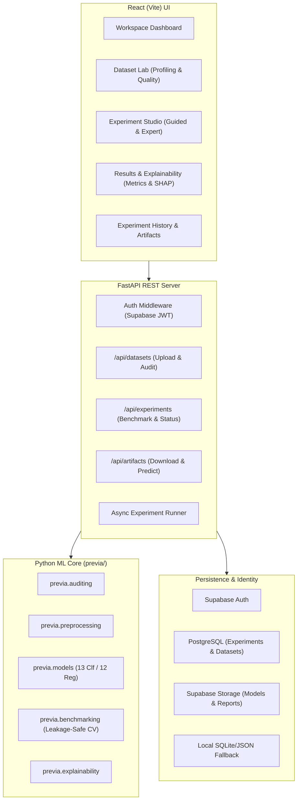

# URQEN v1.0.0 — Product Strategy & Architecture Audit

## 1. Executive Summary & Product Definition

- **Product Name:** URQEN
- **Release:** v1.0.0
- **Product Category:** Tabular Machine Learning Experimentation & Decision-Support Platform.
- **Core Philosophy:** *"Understand the data before trusting the model."*
- **Primary Audience:** Data science students, academic researchers, and independent ML practitioners who work with structured tabular datasets and require defensible, explainable, and leakage-safe machine learning without black-box opacity or subscription paywalls.
- **Commercial Model:** **Guided Mode and Expert Mode are 100% FREE in v1.0.0.** No fake payment gates, no artificial paywalls, no disabled controls.
- **Target Architecture:**
  - **Frontend:** React (Vite) + JavaScript/JSX + Semantic HTML + Coherent CSS Design System + Interactive Visualizations.
  - **Backend:** Python + FastAPI + Pydantic REST API schemas.
  - **Core Engine:** Standalone Python tabular ML package (`previa/` with Pandas, NumPy, Scikit-Learn, XGBoost, SHAP).
  - **Persistence & Auth:** Supabase Auth, PostgreSQL (with Row-Level Security), Supabase Storage (with graceful local fallback when unconfigured).

---

## 2. Phase Zero: Deep Codebase Audit

### 2.1 Existing Functionality Worth Preserving
1. **Core Tabular ML Engine (`previa/`):** 
   - 100% pure Python, decoupled from UI/API frameworks.
   - Comprehensive profiling (`previa.auditing.profiler`): Dimensions, types, missingness, duplicate rows, skewness, summary statistics.
   - Evidence-backed health audit (`previa.auditing.health`): 8-point issue detection with measured evidence strings.
   - Leakage auditor (`previa.auditing.leakage`): Evaluates target-correlated features, suspicious column names, severe class imbalances.
   - Task detection (`previa.task_detection.detector`): Distinguishes binary classification, multiclass classification, and continuous regression with heuristic justification.
   - Preprocessing recommender (`previa.preprocessing.recommender`): Deterministic rules for imputation, scaling, encoding, and dropping.
   - Leakage-safe pipeline builder (`previa.preprocessing.pipeline_builder`): Assembles `ColumnTransformer` with `StandardScaler`, `MinMaxScaler`, `RobustScaler`, or `None`, fitting strictly on training folds.
   - Model Registry (`previa.models.registry`): Unified catalog of 13 classification and 12 regression algorithms with configurable hyperparameters.
   - Benchmarking engine (`previa.benchmarking.benchmarker`): Stratified splitting, CV policy (up to 20 folds, default 10), metric ranking, sensitivity/specificity, holdout confusion matrix.
   - Explainability & Export (`previa.explainability`, `previa.export`): Tree/permutation feature importance, SHAP support, HTML/Markdown report generation, `.joblib` model bundles, and JSON experiment manifests.
2. **Comprehensive Test Suite:** 165 passing unit and integration tests across 19 test modules (`pytest`).

### 2.2 Identified Gaps & Incomplete Behavior
1. **Frontend / Backend Coupling:** The current implementation relies on a monolithic Streamlit UI (`app/app.py`). While functional, it combines UI rendering, local session state, and execution in a single Python thread.
2. **Job Management:** Streamlit blocks synchronously during multi-model CV execution. Long-running grid benchmarks require an asynchronous background task runner in FastAPI.
3. **Data Persistence:** Currently, experiments reside in in-memory `st.session_state` or local scratch files. Multi-user isolation, historical experiment tracking, and storage cleanup require PostgreSQL tables and Supabase Storage integration.
4. **Storage Cleanup & Quota Handling:** Experiment deletion does not yet cascade across database records, physical filesystem artifacts, and cloud storage buckets.

### 2.3 Security & Reliability Gaps
- Uploaded files must be validated for size limits, binary content, and corrupted headers before processing.
- Serialized model bundles (`.joblib`) must be restricted to authenticated owners and validated for schema consistency upon reload.
- Supabase tokens must be verified via JWT authentication on every protected API endpoint.

---

## 3. Phase One: Competitive Landscape & Research

| Evaluation Dimension | H2O-3 / AutoML | PyCaret | AutoGluon Tabular | URQEN v1.0.0 |
| :--- | :--- | :--- | :--- | :--- |
| **Primary Workflow Focus** | Stacked Ensembles & Black-Box Leaderboard | Low-Code Python Notebook CLI | Multi-Layer Stacking & Deep Tabular | **Decision Support: Understand -> Audit -> Benchmark -> Explain** |
| **Data Quality & Leakage Audit** | Basic summary statistics | Automated check in `setup()` | Automated type inference | **Dedicated 8-point Health & Leakage Audit with evidence** |
| **Preprocessing Transparency** | Hidden internal transformations | Automated with config flags | Automated multi-modal transformers | **Explicit per-feature rationale with User Overrides** |
| **Guided vs. Expert Modes** | Expert code-only / H2O Flow GUI | Code-only API | Code-only API | **Two distinct, 100% free modes in visual UI & REST API** |
| **Evaluation Discipline** | Leaderboard CV | K-fold CV | Multi-fold Bagging | **Leakage-Safe ColumnTransformer, strict fold isolation** |
| **Explainability** | H2O Explain module | SHAP & Yellowbrick plots | Feature importance | **Integrated SHAP, Confusion Matrices, Residuals, Reports** |
| **Reproducibility** | MOJO / POJO export | Pipeline pickle | Predictor folder | **Model Bundle + Self-contained JSON Experiment Manifest** |
| **Licensing / Cost** | Open source (commercial Driverless AI) | Open source | Open source | **100% Free Open Product (No paywalls or fake gates)** |

### URQEN's Differentiating Value Proposition
1. **Evidence-Backed Data Intelligence:** URQEN surfaces dataset findings and recommendations for review, including available evidence and trade-offs.
2. **ML Review Signals:** URQEN can surface potential data leakage, high target correlations, identifier memorization, and class imbalance before training.
3. **Two Free Modes (Guided & Expert):** Novice users receive sensible guidance and plain-language explanations; experienced practitioners retain full manual control over algorithms, hyperparameters, scalers, CV folds, and holdout splits.

---

## 4. Phase Plan: Migration to React & FastAPI

### Phased Implementation Milestones
- **Phase A (Complete):** Codebase audit, competitive research, and product strategy document.
- **Phase B (Next):** FastAPI backend service with Pydantic request/response schemas, dataset upload, audit endpoints, and background benchmark runner wrapping `previa/`.
- **Phase C:** Supabase persistence integration (PostgreSQL schema, Row Level Security, object storage, and local fallback).
- **Phase D:** React + Vite frontend application with design tokens, Workspace Dashboard, Dataset Lab, Experiment Studio, Results & Explainability, and History views.
- **Phase E:** Rigorous testing (Pytest API tests, frontend build verification, quota & cleanup verification).
